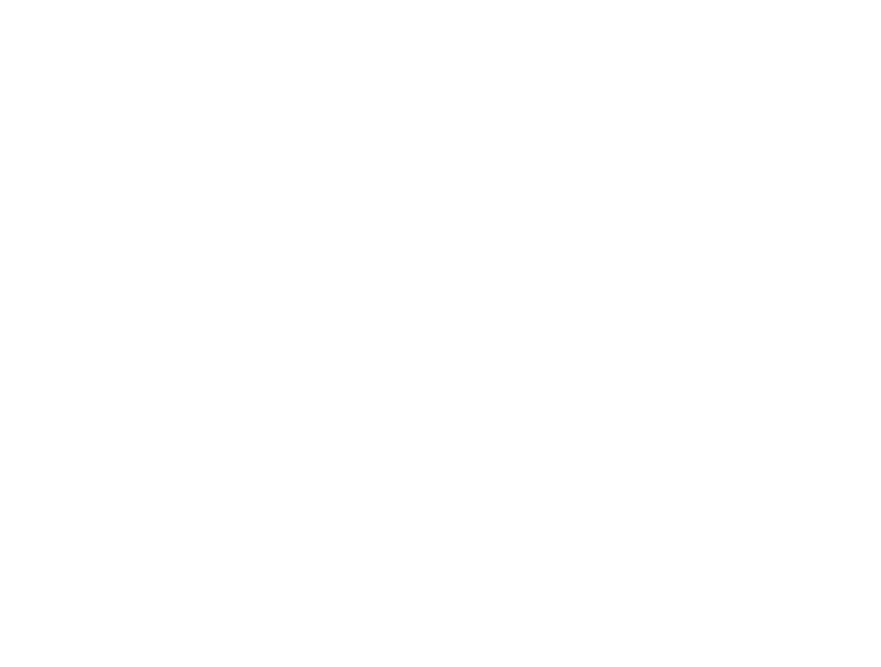

# Dublin Bikes — ocupação das estações

Análise descritiva de seis meses de leituras do sistema de bicicletas compartilhadas de Dublin, janeiro a junho de 2026, com 3,4 milhões de registros e 115 estações.

A pergunta: como a disponibilidade de bicicletas varia ao longo do dia, e a média da cidade descreve bem esse comportamento?

## Resultado



A ocupação média da cidade varia só 3 pontos percentuais em 24 horas, e isso acontece por construção, bicicleta não desaparece do sistema, ela muda de lugar, então o que uma estação perde a outra ganha e a média se anula.

O comportamento real está na diferença entre estações. Killarney Street sai de 89% de ocupação às 4h para 29% às 11h, enquanto Molesworth Street faz o movimento oposto no mesmo intervalo, de 18% para 78%. As curvas se cruzam às 7h e às 17h, exatamente nos horários de deslocamento casa-trabalho.

A estação de maior amplitude varia 61 pontos percentuais ao longo do dia, contra 3 da média da cidade.

Dia da semana tem efeito pequeno, fim de semana fica cerca de 2 pontos percentuais acima dos dias úteis.

## Decisões de limpeza

1. **Carga** — seis CSVs mensais lidos em loop e concatenados em uma única base de 3,4M linhas
2. **Inspeção** — nulos, duplicatas, tipos e contagem de valores distintos por coluna
3. **Limpeza** — remoção de colunas sem informação e de leituras de estações fora de operação, conversão de `last_reported` para datetime
4. **Derivação** — hora e dia da semana extraídos do timestamp, ocupação calculada como bikes sobre o total de vagas reportado
5. **Agregação** — média de ocupação por hora, por dia da semana e por estação
6. **Comparação** — amplitude diária de cada estação contra a média da cidade

## Estrutura

```
dublin-bikes/
├── data/
│   ├── raw/            # CSVs mensais, não versionado
│   └── processed/
├── notebooks/
│   ├── 01_load_and_clean.ipynb
│   └── 02_analysis.ipynb
├── reports/figures/
├── requirements.txt
└── README.md
```

## Como rodar

```bash
python -m venv .venv
source .venv/bin/activate
pip install -r requirements.txt
jupyter notebook
```

Os dados brutos não são versionados por causa do tamanho. Baixe os CSVs históricos em [data.gov.ie](https://data.gov.ie), coloque em `data/raw/` e rode os notebooks na ordem.

## Stack

Python, pandas, matplotlib.
